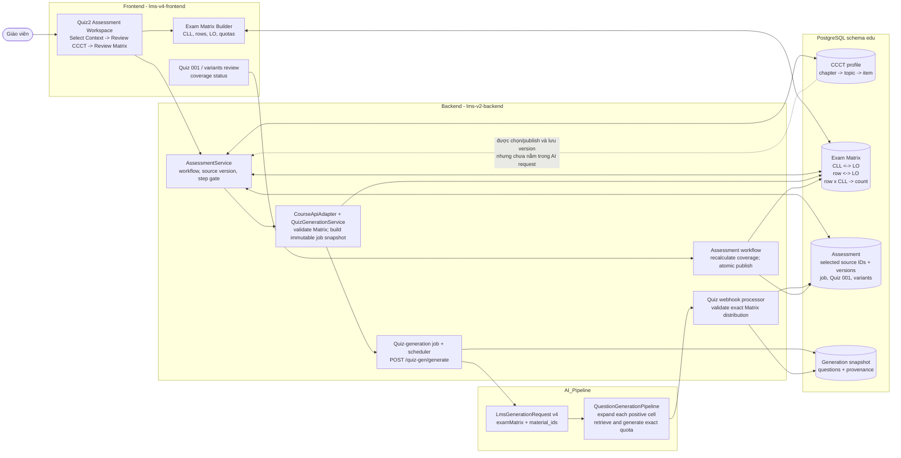
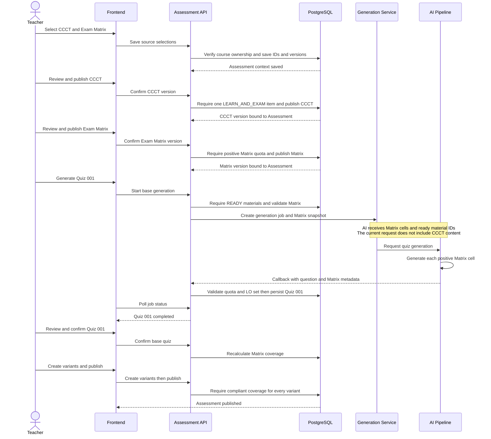
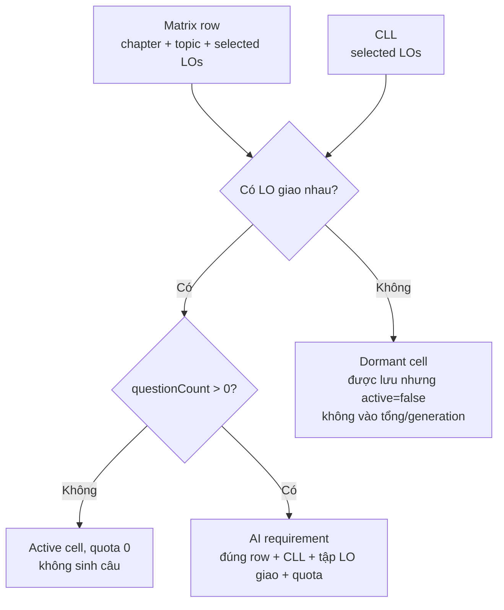

# CCCT và Exam Matrix trong luồng tạo Quiz2

> Phạm vi: luồng `STANDARD` tạo **Quiz 001** rồi tạo các biến thể. Tài liệu phân biệt rõ giữa quy trình UX mong muốn, ràng buộc được Backend cưỡng chế, và dữ liệu thực sự đi vào AI tại thời điểm khảo sát mã nguồn.

## Kết luận ngắn

- **CCCT** là hợp đồng nội dung/chương trình học: cấu trúc bám theo chương của môn, đánh dấu nội dung `LEARN_AND_EXAM`, và được chọn/xuất bản trong Assessment trước khi làm Quiz 001.
- **Exam Matrix** là blueprint thực thi của đề: mỗi ô `(Matrix row, CLL)` có số câu; ô đó xác định chapter, topic, LO và cấp độ nhận thức cho AI. Đây là nguồn ràng buộc trực tiếp cho số lượng, phân bổ, kiểm tra callback và kiểm tra trước publish.
- Không phải “ít nhất 1 CLL”. Matrix hoàn chỉnh cần **ít nhất 3 CLL**; mỗi CLL có ít nhất 1 LO; mọi LO của course phải thuộc ít nhất 1 CLL.
- “Mọi LO phải có câu hỏi” **chưa phải** là ràng buộc hiện hữu. Mã yêu cầu mọi LO được phủ bởi CLL, nhưng chỉ các ô *active* có `questionCount > 0` mới tạo yêu cầu sinh câu. Vì vậy một LO có thể thuộc CLL nhưng không nhận quota câu dương.
- CCCT là bắt buộc ở màn Select Context và có bước publish riêng. Tuy nhiên, payload `/quiz-gen/generate` hiện chỉ mang Matrix + materials; không mang CCCT profile/nội dung/item. Backend cũng chưa kiểm tra rõ trạng thái CCCT Published ngay tại `startBaseGeneration`. Vì vậy CCCT hiện là cổng workflow/audit, **chưa là ràng buộc AI trực tiếp** như Exam Matrix.

## Thuật ngữ và mô hình nghiệp vụ

| Khái niệm | Vai trò trong đề | Đơn vị dữ liệu then chốt |
| --- | --- | --- |
| LO (Learning Outcome) | Kết quả học tập thuộc course | `learning_outcomes` |
| CLL (Custom Learning Level) | Cấp độ nhận thức do giáo viên định nghĩa, liên kết một hay nhiều LO | `custom_learning_levels` và liên kết LO |
| Matrix row | Phạm vi nội dung: một chapter, một topic, và các LO được chọn | `exam_matrix_rows` + `exam_matrix_row_learning_outcomes` |
| Matrix cell | Một cặp `(row, CLL)` cùng quota câu; là đơn vị giao việc cho AI | `exam_matrix_row_learning_level_counts` |
| CCCT | Cấu trúc coverage nội dung theo chapter/topic/item; item có trạng thái như `LEARN_AND_EXAM` | `ccct_profiles`, `ccct_chapters`, `ccct_topics`, `ccct_items` |

Một cell chỉ **active** khi CLL và Matrix row có LO chung. Count không còn LO chung được lưu lại nhưng là *dormant*: không được đưa vào tổng quota hay generation.

## Component diagram

## Sequence diagram: tạo và phát hành Standard Quiz2

## Ràng buộc của Exam Matrix

### 1. Ràng buộc cấu trúc và coverage

| Ràng buộc | Nơi cưỡng chế chính | Ý nghĩa |
| --- | --- | --- |
| Tối thiểu **3 CLL** | BE CLL service; kiểm tra lại trước generation | Một Matrix chỉ có 1 hoặc 2 CLL không hoàn chỉnh; không dùng để sinh Quiz chuẩn. |
| Mỗi CLL có tối thiểu 1 LO | BE request/service | CLL rỗng bị từ chối. |
| Mọi LO của course thuộc ít nhất 1 CLL | BE CLL service; `uncoveredLearningOutcomeIds` | Đây là câu trả lời cho “phải có hết LO”: **có, ở tầng CLL coverage**. LO có thể ở nhiều CLL. |
| Code và name CLL duy nhất trong Matrix | BE CLL service | Code không phân biệt hoa/thường; tránh hai CLL mơ hồ. |
| Mỗi row có chapter, topic không rỗng, ít nhất 1 LO | BE Matrix validator | Row phải gắn đúng chapter của course; LO phải thuộc course và thuộc chapter đó. |
| Không trùng `orderIndex`, LO trong row, hoặc CLL trong row | BE Matrix validator | Duy trì thứ tự và định danh cell nhất quán. |
| CLL dùng trong row phải thuộc chính Matrix | BE Matrix validator | Không dùng CLL từ Matrix khác. |
| Loại câu của Matrix hiện chỉ là `MULTIPLE_CHOICE` | BE Matrix validator | Đây là giới hạn Phase 4/Quiz2 hiện tại. |
| `questionCount >= 0` cho một cell; tổng quota phải `> 0` | DB check + confirm Matrix + generation | Cell 0 là hợp lệ nhưng không sinh câu; cả Matrix phải có ít nhất một quota dương. |

### 2. Khi nào một CLL thực sự tạo câu?

`row × CLL` chỉ thành cell sinh câu khi có LO giao nhau và `questionCount > 0`.

Hệ quả quan trọng: hiện không có kiểm tra “mỗi LO của course phải có ít nhất một câu”. Mã chỉ ép LO được map vào CLL; một CLL/cell có thể có quota 0. Muốn biến điều này thành quy định nghiệp vụ, cần bổ sung validation riêng: với mỗi LO, tồn tại ít nhất một cell active có `questionCount > 0` và LO đó nằm trong tập LO của cell.

Lưu ý hai tầng gate: API **confirm Matrix** đang cộng mọi count đã lưu để kiểm tra tổng dương; generation lại chỉ dùng cell active. Vì vậy một Matrix chỉ có count dormant có thể qua bước confirm nhưng sẽ bị chặn muộn hơn khi generation nhận tổng quota active bằng 0. Đây là hành vi hiện tại, không nên diễn giải nhầm là Matrix đó đã đủ điều kiện sinh đề.

### 3. Ràng buộc trong generation và callback

Exam Matrix được snapshot khi tạo job. AI không được tự thay đổi blueprint:

1. Backend gửi từng row gồm chapter/topic/LO và từng CLL có quota, type, LO liên quan.
2. AI Pipeline bỏ qua quota 0, tạo một requirement cho từng `(row, CLL)` còn lại và sinh đúng `questionCount`.
3. Callback phải trả lại `matrixRowId`, `customLearningLevelId`, `originalType`, và đúng tập LO.
4. Backend từ chối callback nếu số câu, Matrix cell, type, tập LO hoặc visual quota khác snapshot.
5. Khi confirm Quiz 001 và khi publish, Backend tính lại coverage của từng variant. Mỗi cell phải có đúng số câu MCQ và đúng tập LO; trạng thái `DRIFTED` chặn publish.

Vì vậy Matrix không chỉ là UI để “phân bổ dự kiến”: nó là hợp đồng đầu vào/đầu ra có khả năng kiểm chứng.

## Vai trò và ràng buộc của CCCT

CCCT bảo đảm đề được đặt trong một cấu trúc nội dung có kiểm soát:

- Profile format hiện hành là v2; phải chứa **mỗi Course Chapter đúng một lần**, đúng thứ tự và đúng tiêu đề.
- Khi publish, CCCT phải có ít nhất một item `LEARN_AND_EXAM` gắn với chapter hợp lệ.
- Assessment lưu `ccct_profile_id` và version đã review/publish. Nếu source là Draft, UI/BE publish để khóa source; Published source là read-only. Sau khi AI generation bắt đầu, source không thể reopen.

Điểm cần phân biệt:

| Lớp | Điều CCCT hiện làm | Điều CCCT hiện chưa làm trong Standard Quiz2 |
| --- | --- | --- |
| FE | Bắt người dùng chọn CCCT ở Select Context; có Step 3 Review CCCT | Không tự chứng minh CCCT được đưa vào request AI. |
| BE workflow | Bind ID/version, publish Draft, kiểm tra có `LEARN_AND_EXAM`, cho rollback trước AI | `startBaseGeneration` chỉ kiểm tra `currentStep >= 5` và có Matrix; không kiểm tra rõ CCCT đã Published. |
| AI contract | Có endpoint AI riêng để tạo/cấu trúc CCCT | `/quiz-gen/generate` v4 không nhận CCCT profile/item/content; không thể grounding câu hỏi theo CCCT. |
| DB/audit | Lưu cấu trúc CCCT và version được Assessment chọn | Không có snapshot CCCT được tiêu thụ bởi job Standard hiện tại. |

Nói cách khác: UI mô tả rằng server dùng “reviewed CCCT, Exam Matrix, ready materials”, nhưng code contract hiện tại chỉ chứng minh trực tiếp phần **Exam Matrix + materials**. Đây là khoảng cách giữa ý đồ nghiệp vụ và ràng buộc kỹ thuật cần được biết khi đánh giá compliance.

## Phân công bắt buộc giữa FE, BE, AI và DB

| Thành phần | Bắt buộc phải làm | Không nên tự quyết thay tầng khác |
| --- | --- | --- |
| FE | Thu thập source selection; dẫn người dùng qua review; hiển thị version/job/coverage; gửi option count 4 hoặc 5 và variant count 1–20 | Không coi validation UI là nguồn chân lý; không tự suy diễn coverage. |
| BE | Phân quyền teacher/course; kiểm tra source/version/lifecycle; validate Matrix; snapshot job; kiểm tra callback; tính lại coverage; publish atomically | Không để AI tự quyết quota hay chấp nhận callback chỉ vì cú pháp hợp lệ. |
| AI | Chấp nhận contract v4; kiểm tra shape Matrix; mở rộng cell quota dương; RAG từ materials; trả đúng metadata Matrix và số câu | Không được tạo ngoài Matrix cell/LO/quota hoặc đổi loại câu. |
| DB | Lưu graph CCCT/Matrix, source version, job snapshot, provenance, variant coverage để transaction/audit | Không thay thế domain validation bằng constraint đơn giản; nhiều quy tắc là quan hệ giữa course, row, CLL và LO. |

## Các cổng chặn theo luồng Standard

1. **Select Context:** cả CCCT và Exam Matrix phải được chọn/tạo/copy và phải thuộc course.
2. **Review CCCT:** publish Draft yêu cầu ít nhất một `LEARN_AND_EXAM`.
3. **Review Matrix:** publish Matrix yêu cầu tổng quota dương; generation sau đó kiểm tra completeness đầy đủ (3 CLL, mọi LO được map CLL, row hợp lệ).
4. **Create Quiz 001:** materials phải `UPLOADED + READY`, phải có material; Quiz2 ép MCQ và 4/5 đáp án.
5. **Callback AI:** phân bổ phải khớp snapshot Matrix chính xác.
6. **Confirm Quiz 001:** số câu bằng tổng quota Matrix, có metadata, đúng cấu trúc/rich content và coverage `COMPLIANT`.
7. **Publish:** Quiz 001 đã confirm; đủ số variants; mọi variant giữ cấu trúc và coverage `COMPLIANT`. Override coverage có lý do vẫn **không** vượt qua được cổng publish.

## Khuyến nghị nếu muốn CCCT thật sự là ràng buộc sinh đề

Đây là thay đổi nghiệp vụ/kỹ thuật đề xuất, chưa phải hành vi hiện tại:

1. Trước `startBaseGeneration`, bắt buộc `ccct_profile_id` đang Published và version đúng Assessment đã confirm.
2. Tạo mapping tường minh `Matrix row -> CCCT LEARN_AND_EXAM item(s)`; không suy luận bằng tên chapter/topic.
3. Snapshot mapping cùng Matrix vào job và thêm các `ccctItemId`/nội dung cần thiết vào contract AI.
4. Cho AI trả `ccctItemId`; Backend xác minh mỗi câu khớp cả Matrix cell lẫn CCCT item thuộc Assessment snapshot.
5. Nếu chính sách yêu cầu mọi LO đều được đánh giá, thêm coverage rule theo LO có quota dương, không chỉ CLL coverage.

## Nguồn mã đã đối chiếu

- FE: `src/features/quiz2/AssessmentWorkspace.tsx`, `src/features/courses/model/exam-matrix-builder.ts`.
- BE Matrix/CLL: `ExamMatrixValidator`, `CustomLearningLevelService`, `CourseApiAdapter`, `AssessmentRepository`.
- BE Quiz2/generation: `AssessmentService`, `QuizGenerationService`, `QuizGenerationProcessingService`, `QuizWebhookProcessingService`, `AssessmentWorkflowRepository`.
- AI: `src/lms/schemas.py`, `src/pipeline/question_generation_pipeline.py`.
